<div align="center">

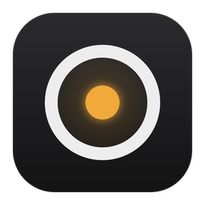

# OpenSir

**Open-source configurator for GameSir controllers.**

[](LICENSE)    

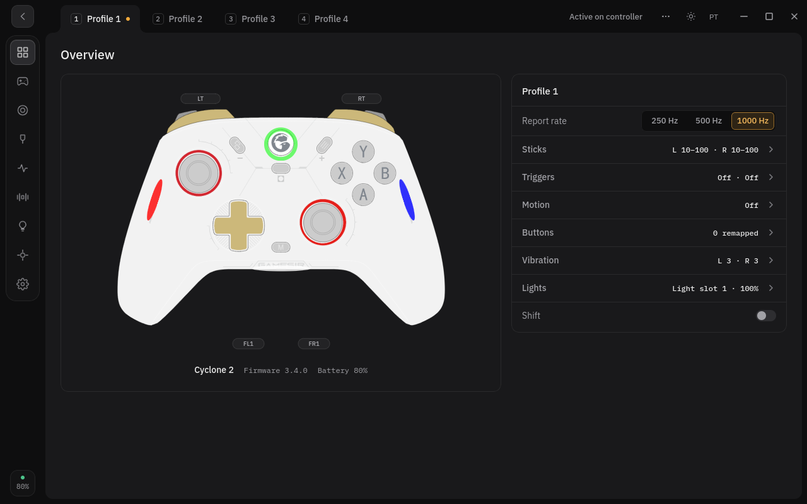

</div>

OpenSir replaces the official GameSir Connect app. The Cyclone 2 is fully supported and verified on hardware. The Tarantula CE, G7 Pro 8K and K2 8K are detected and read-only for now.

OpenSir is a clean-room reimplementation of the protocol. The protocol was documented from observed vendor-app behaviour and captures on real hardware (see `docs/`), then the code was written from those documents. Controller cover images are described in the [Artwork notice](#artwork-notice).

## Features

- **Buttons:** remap any button, turbo, macros on the back keys.
- **Sticks and triggers:** deadzones, anti-deadzones and response curves (linear, concave/convex, S-curve, custom points), hair triggers.
- **Motion:** gyro output to a stick, the mouse pointer or the scroll wheel.
- **Vibration:** per-motor rumble levels, including the trigger motors.
- **Lights:** RGB presets, per-frame colours, brightness and speed.
- **Button test:** live view of sticks, triggers and pressed buttons.
- **Four profiles** plus the shift layer, light and dark themes, English and Portuguese.

## Screenshots

<table>
  <tr>
    <td width="50%">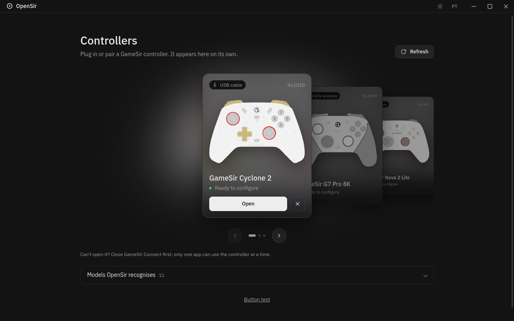<br><sub><b>Controllers:</b> plug in or pair a controller and it shows up.</sub></td>
    <td width="50%">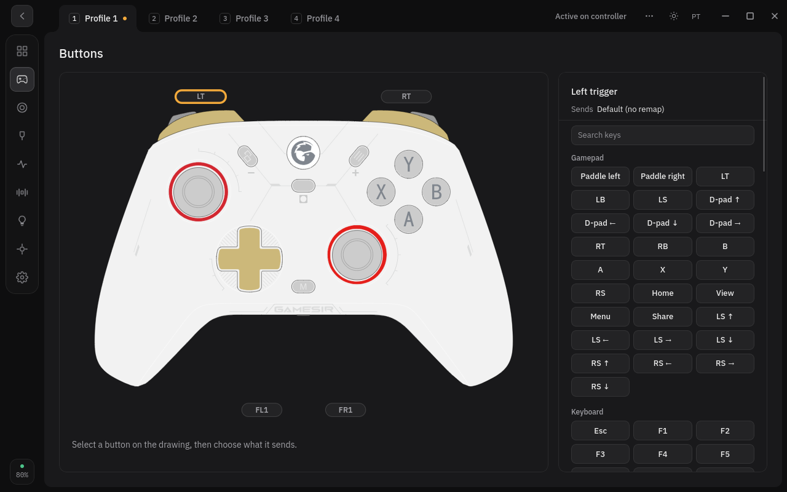<br><sub><b>Buttons:</b> pick a button on the drawing, choose what it sends.</sub></td>
  </tr>
  <tr>
    <td>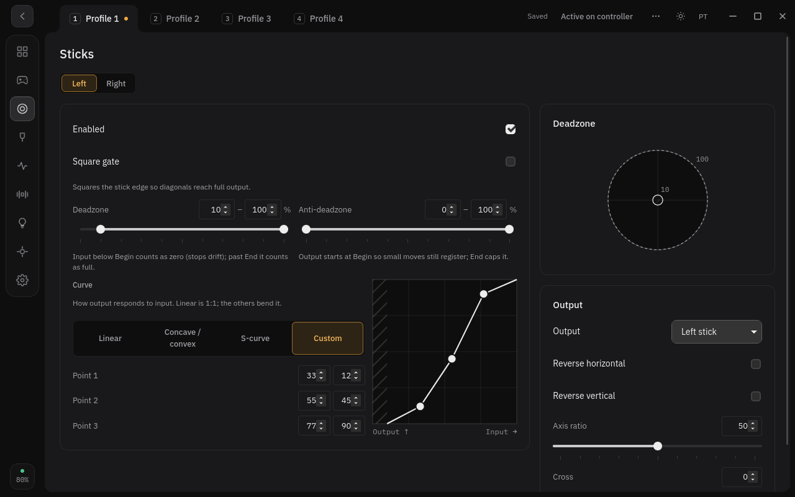<br><sub><b>Sticks:</b> deadzone, anti-deadzone and a custom curve.</sub></td>
    <td>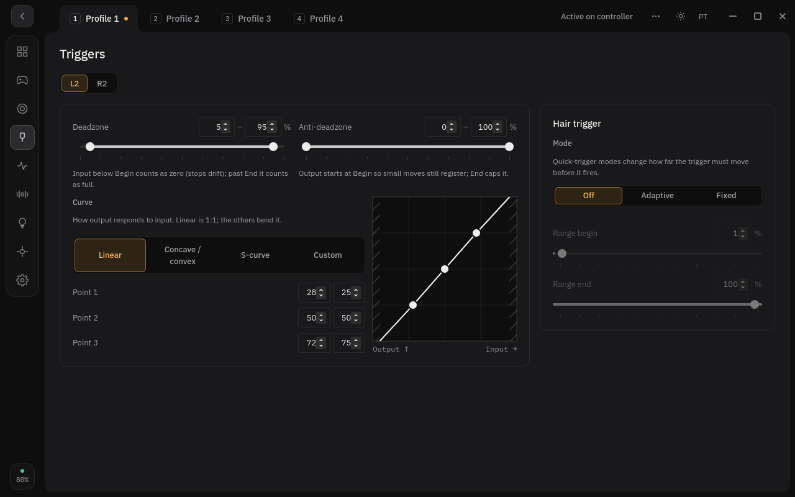<br><sub><b>Triggers:</b> ranges, curve and hair-trigger modes.</sub></td>
  </tr>
  <tr>
    <td>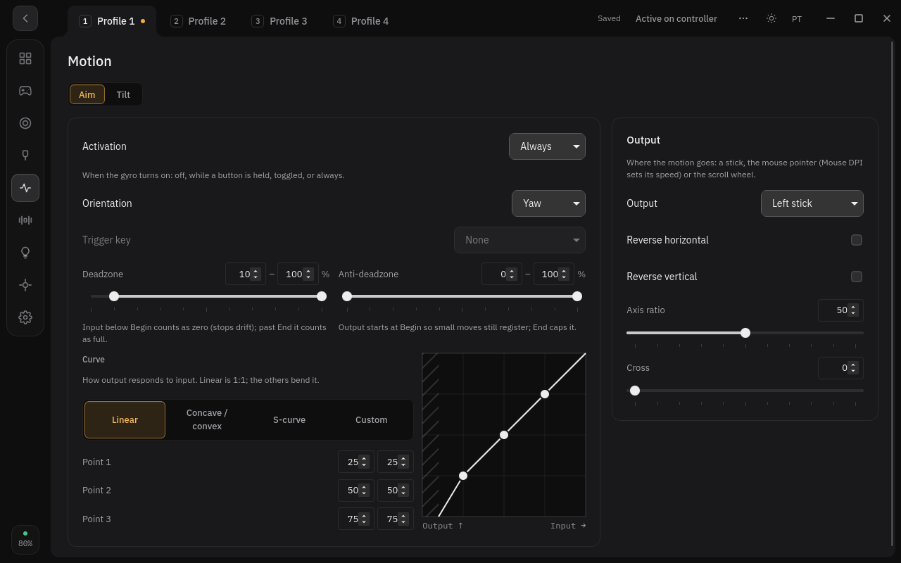<br><sub><b>Motion:</b> gyro activation, orientation and output.</sub></td>
    <td>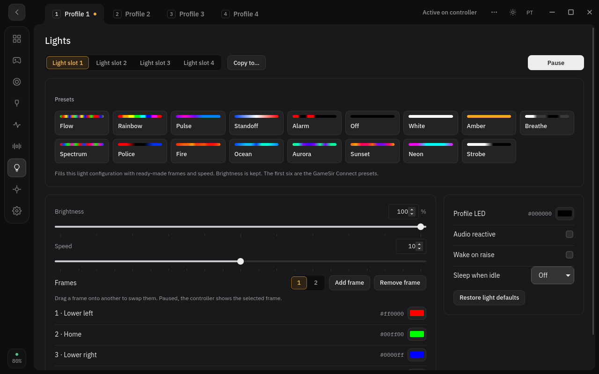<br><sub><b>Lights:</b> presets, frames, brightness and speed.</sub></td>
  </tr>
  <tr>
    <td>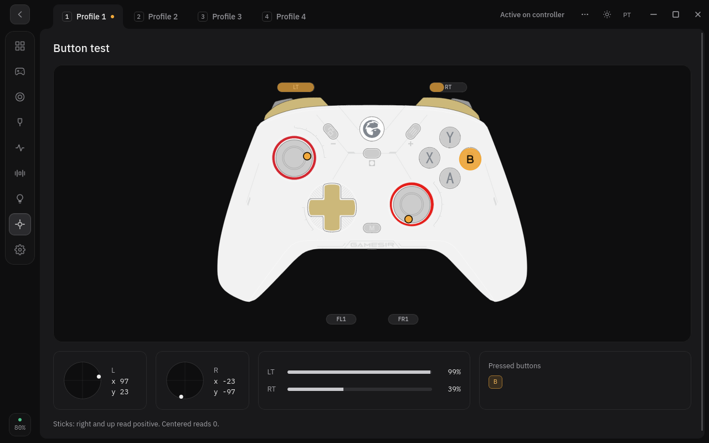<br><sub><b>Button test:</b> live sticks, triggers and buttons.</sub></td>
    <td>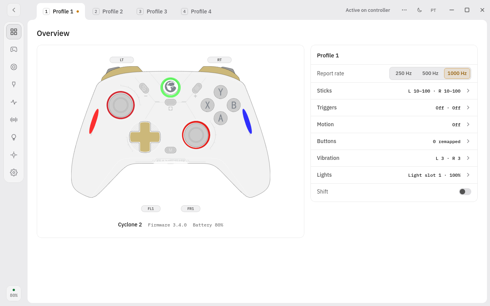<br><sub><b>Light theme</b></sub></td>
  </tr>
</table>

<details>
<summary>More screens</summary>

| Vibration | Profile settings |
|---|---|
| 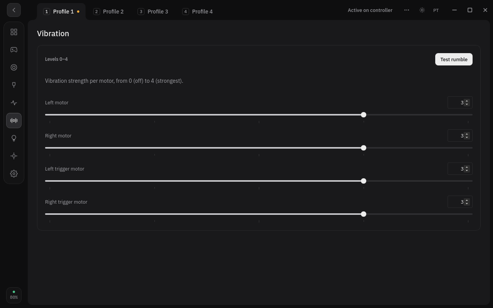 | 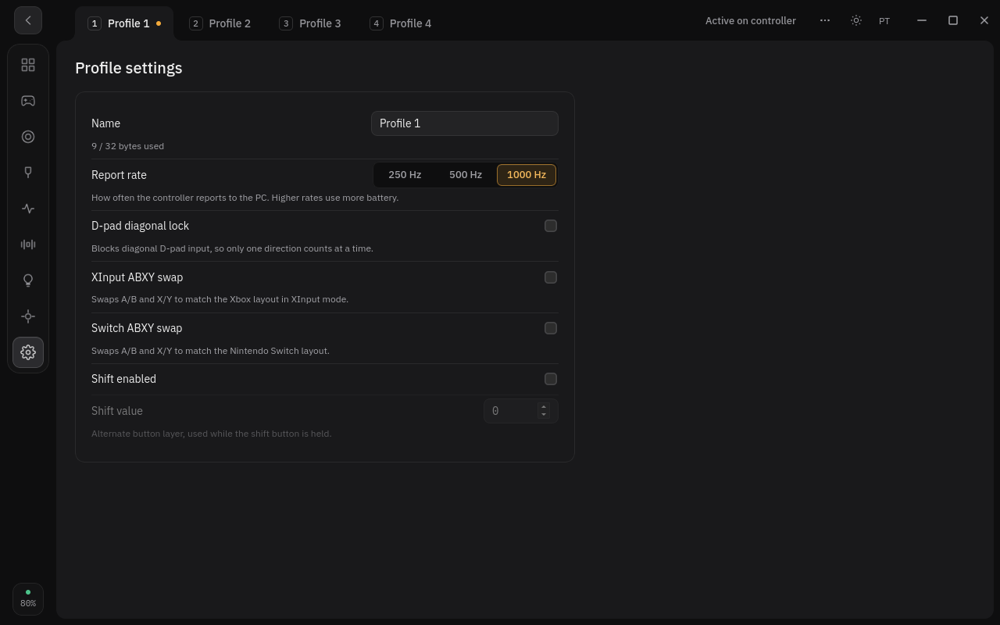 |

</details>

Screenshots were taken from the browser preview (`npm run dev`) with a simulated Cyclone 2.

## Status

| Area | State |
|---|---|
| Cyclone 2: read profiles 1–4, shift profile, light profile, firmware, active profile | verified on a real Cyclone 2 (firmware 3.4.0, dongle 1.2.1) |
| Cyclone 2: write profile changes (diff writes, ≤58-byte chunks) | verified on a real Cyclone 2: write, read back, byte-exact restore |
| Profile codec (680 bytes) | 30 golden vectors: 9 produced from the vendor encoder's observed output, 21 real device blobs (22 round-trip byte-exact) |
| Light codec (635 bytes) | 12 real device blobs round-trip byte-exact |
| Tarantula CE, G7 Pro 8K, K2 8K | detected and **read-only**. OpenSir does not write to them until the write path is tested on real hardware. Profiles, hotspots and the official cover are implemented (`docs/protocol/hid-family-profile.md`); not yet tried on real hardware |
| Tarantula Pro, Nova Pro, Nova 2 Lite, Nova Vision, T3XS | protocol documented from observed vendor-library behaviour (`docs/protocol/sapjoy-gs3.md`, `sapjoy-t3pro.md`); frame builders are tested against those frames; listed with the official cover (browser preview can open them), not configurable on hardware |
| Tegenaria Lite | protocol documented (`docs/protocol/t3lite.md`), listed with the official cover, not configurable yet |
| Firmware update | not implemented, on purpose |

## Safety

OpenSir is built to avoid damaging a controller or saving bad data:

- Writes are diff-only: only the bytes that differ from the device are sent.
- Busy acknowledgements from the controller are retried after a short delay.
- Every write is read back and verified against what was sent.
- Values are validated at the IPC boundary before they reach the protocol code.
- Only one OpenSir instance runs at a time.
- Pending saves are flushed before the window closes.
- OpenSir never sends firmware, calibration or DFU commands.

## Controller mode

Configuration works only when the controller enumerates in a config-capable mode:

| PID | Mode |
|---|---|
| 0x101D | wired |
| 0x102A | wireless |
| 0x1053 | wired (ADC) |
| 0x100B | 2.4G dongle (ADC) |

Any other PID (for example 0x0575) is shown as "not in config mode" and nothing is sent to it. Tarantula CE (0x103D, 0x090D), G7 Pro 8K (0x10B7, 0x10B9 and the other theme PIDs in `crates/opensir-core/src/models.rs`) and K2 8K (0x108E, 0x109F) are opened on their usage-page 0xFFF0 interface like the Cyclone 2.

**Close GameSir Connect before using OpenSir.** Only one application can hold the controller at a time.

## Build

Requirements (Windows):

- Rust stable with the MSVC toolchain. Install Visual Studio Build Tools with the "Desktop development with C++" workload.
- Node 22.
- WebView2 runtime (included with Windows 11 and most current Windows 10 installs).

```sh
npm install
npm run tauri dev        # run the app
npm run tauri build      # release exe + NSIS installer in target/release
cargo test --workspace   # protocol tests against the golden vectors
```

Command-line tool (read-only):

```sh
cargo run -p opensir-cli -- list
cargo run -p opensir-cli -- dump "<device id from list>" --json
```

The UI also runs in a plain browser with simulated controllers: `npm run dev`. The controller list there can plug in and unplug any known GameSir model.

See [CONTRIBUTING.md](CONTRIBUTING.md) before opening a pull request.

## Layout

| Path | Contents |
|---|---|
| `crates/opensir-core` | protocol, codecs, HID transport, device session |
| `crates/opensir-cli` | read-only CLI |
| `src-tauri` | Tauri 2 shell (commands and events) |
| `src` | SvelteKit UI |
| `docs/protocol` | wire protocol, profile/light/shift layouts, key codes, input report, golden vectors |
| `docs/spec` | screen inventory of the vendor app (facts only) |
| `docs/architecture.md` | module layout and the UI ↔ backend contract |

## Artwork notice

- The controller images in `static/pads/` are GameSir's official artwork. They are included only to identify each supported model. Hotspot positions for each model are in `src/lib/pads/`. No GameSir code or firmware is included.
- "GameSir", "Cyclone", "Tarantula", "Nova", "Tegenaria" and other product names are trademarks of their respective owners.
- OpenSir is not affiliated with or endorsed by GameSir.
- Rights holders who want any image removed can open an issue at https://github.com/pendiego/OpenSir/issues, or ask privately through a GitHub security advisory (see [SECURITY.md](SECURITY.md)). It will be removed promptly.

## License

MIT, see `LICENSE`.
